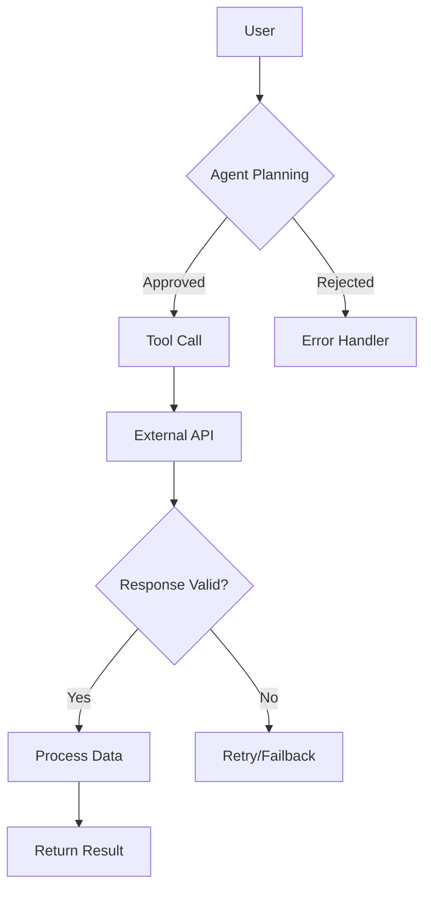

# Архитектурный Агентский Навык Archify: Исследовательский Отчет Профессора

## 📋 Аннотация
Archify — это агентский навык для генерации профессиональных архитектурных, workflow, sequence, data-flow и lifecycle диаграмм из естественного языка или Mermaid-кода в виде автономных HTML-файлов с встроенной SVG-графикой. Навык создает самодостаточные, интерактивные и проверяемые технические diagramмы без внешних зависимостей, что делает их идеальными для документации, коммуникации и версионного контроля в проектах типа Living Code.

## 🔍 Ключевые характеристики

| Параметр | Описание |
|----------|----------|
| **Название** | Archify — Agent skill for beautiful, verifiable architecture diagrams |
| **Автор** | tt-a1i (https://github.com/tt-a1i/archify) |
| **Лицензия** | MIT |
| **Язык реализации** | JavaScript/Node.js |
| **Основная функция** | Генерация self-contained HTML+SVG диаграмм из plain English или Mermaid |
| **Поддерживаемые типы диаграмм** | Архитектурные, workflow, sequence, data-flow, lifecycle/state |
| **Экспорт форматы** | PNG, JPEG, WebP, SVG (до 4× исходного разрешения) |
| **Особенности** | Built-in dark/light theme toggle, motion effects, path-aware storytelling, semantic camera, проверяемость через routed facts |
| **Последняя версия** | v2.16.0-dev.0 (разработка), v2.14.0 (стабильная) |

## 🏗️ Техническая архитектура

### Core Components
Archify состоит из нескольких ключевых модулей:

1. **Парсер входных данных** (`shared/cli.mjs`) — обработка командной строки и входных параметров
2. **Валидатор схем** (`shared/validator.mjs`) — проверка входных JSON-схем для каждого типа диаграммы
3. **Геометрический движок** (`shared/geometry.mjs`) — вычисления расположения элементов, маршрутизации соединений
4. **Рендереры по типам** (`renderers/`) — отдельные модули для каждого типа диаграммы:
   - architecture renderer
   - workflow renderer  
   - sequence renderer
   - data-flow renderer
   - lifecycle renderer
5. **Экспортёр** — генерация PNG/JPEG/WebP/SVG и share cards
6. **Валидатор качества** — 9-point artifact check system для обеспечения качества_output

### Инновационные особенности

1. **Grounded Interactions** — Каждый элемент диаграммы трассируется до исходного описания через:
   - Поиск узлов в репозитории кода
   - Отслеживание upstream/downstream reach
   - Сравнение ролей и точное воспроизведение отношений
   - Игра guided stories без выдумывания топологии

2. **One File, Ready to Trust and Share** — Типизированный JSON промежуточное представление (IR) с детерминированными проверками производит:
   - Один HTML файл без внешних зависимостей
   - PNG, SVG, WebM форматы
   - 1200×630 share cards для documentación и социальных сетей

3. **Интерактивное исследование** — Progressive detail levels:
   - MAP view: высокоуровневый обзор
   - READ view: средняя детализация с контекстом
   - FULL view: полная техническая спецификация

4. **Semantic Camera System** — Автоматическое фокусирование на релевантных частях диаграммы при исследовании конкретных путей или отношений

## 💡 Примеры использования

### Базовая архитектурная диаграмма
```bash
# Установка навыка глобально
npx skills add tt-a1i/archify -g

# Генерация диаграммы из описания
archify "User submits request -> Agent validates -> Calls external API -> Processes response -> Returns result"
```

### Из Mermaid кода


### Специализированные диаграммы
- **Workflow diagrams** с swimlanes для показа ответственности между компонентами
- **Sequence diagrams** для отображения API call chains и request lifecycles
- **Data flow diagrams** для иллюстрации ETL/ELT pipelines и данных lineage
- **Lifecycle/state diagrams** для объектных состояний и переходов статусов
- **Architecture diagrams** для системы, инфраструктуры, безопасности и network topology

## 🎯 Преимущества для Living Code экосистемы

### 1. Улучшение коммуникации и документирования
- Автоматизация создания технических diagramмов из естественного языка
- Устранение разрыва между описанием в чате и визуальной документацией
- Самодостаточные HTML файлы легко встраиваются в README, wiki и документацию

### 2. Проверяемость и аудит
- Каждый элемент диаграммы можно проследить до исходного требования
- Возможность проверить, что диаграмма точно отражает код или спецификацию
- Устранение проблемы "драйфта документации" относительно实际 код

### 3. Интеграция с существующими инструментами
- Совместимость с Mermaid синтаксисом, уже используемым в проекте
- Экспорт в форматы, подходящие для GitHub/GitLab (SVG с темной/светлой темой)
- Возможность генерации diagramмов непосредственно в агентских workflows

### 4. Образовательная ценность
- Наглядное представление сложных систем для новых участников команды
- Визуализация архитектурных решений и паттернов проектирования
- Демонстрация потоков данных и управляющих логик

## 🔧 Интеграция в Living Code workflow

### Рекомендуемые точки применения
1. **Автоматическое генерирование diagramмов** при описании архитектуры в чате
2. **Обновление документации** при изменении системной архитектуры
3. **Обучение новых членов команды** через интерактивные diagramмы
4. **Pre-commit проверки** архитектурной целостности
5. **Генерация отчетов** для sprint review и планирования

### Технические шаги интеграции
1. Добавить Archify в список рекомендуемых навыков в `Учебник.md`
2. Создать скрипт-обертку для автоматического вызова из агентских workflows
3. Настроить хуки для генерации diagramмов при определенных триггерах
4. Интегрировать с существующей системой тегирования и отслеживания тем
5. Создать шаблоны для часто используемых типов diagramмов в проекте

### Пример интеграции с Professor Agent
```python
# В professor_sync.py или отдельном модуле
def generate_architecture_diagram(description, output_path):
    """
    Генерирует архитектурную диаграмму из описания
    и сохраняет в указанный путь
    """
    import subprocess
    import os
    
    # Формируем команду
    cmd = [
        "npx", "skills", "use", "tt-a1i/archify",
        "--skill", "archify",
        "--input", description,
        "--output", output_path
    ]
    
    # Выполняем генерацию
    result = subprocess.run(cmd, capture_output=True, text=True)
    
    if result.returncode != 0:
        raise RuntimeError(f"Archify generation failed: {result.stderr}")
    
    return output_path
```

## 📊 Сравнение с альтернативными решениями

| Критерий | Archify | Mermaid CLI | Draw.io | Excalidraw |
|----------|---------|-------------|---------|------------|
| **Самодостаточность** | ✅ Zero deps HTML | ❌ Требует JS runtime | ❌ Требует приложение/сервер | ❌ Требует приложение |
| **Версионный контроль** | ✅ Текстовый JSON IR + HTML | ✅ Текстовый Mermaid | ❌ Бинарные файлы | ❌ Бинарные файлы |
| **Интеграция с агентами** | ✅ Естественный язык вход | ❌ Требует парсинга | ❌ GUI только | ❌ GUI только |
| **Проверяемость** | ✅ Трассировка к требованиям | ❌ Только синтаксис | ❌ Нет | ❌ Нет |
| **Экспорт качества** | ✅ До 4× resolución, motion | ❌ Базовый SVG/PNG | ✅ Высокое | ✅ Высокое |
| **Тема поддержка** | ✅ Built-in dark/light toggle | ❌ Требует кастомизации | ✅ Через интерфейс | ✅ Через интерфейс |
| **Learning curve** | ✅ Естественный язык | ✅ Простой синтаксис | ❌ Сложный GUI | ❌ Сложный GUI |

## 🚀 Рекомендации по внедрению

### Краткосрочные действия (1-2 недели)
1. [ ] Установить Archify глобально в окружении разработки
2. [ ] Добавить запись в `Учебник.md` с тегом `#researcher:ТекущаяДата`
3. [ ] Создать базовый скрипт интеграции с Professor Agent
4. [ ] Провести пилотное тестирование на одном из активных проектов (SuperGuard или GodModeCoder)

### Среднесрочные действия (1 месяц)
1. [ ] Разработать шаблоны для часто используемых типов diagramмов в Living Code
2. [ ] Интегрировать генерацию diagramмов в workflow документирования
3. [ ] Настроить автоматическое обновление diagramмов при изменении архитектуры
4. [ ] Создать руководство по лучшим практикам использования Archify в команде

### Долгосрочные действия (3+ месяца)
1. [ ] Разработать кастомные рендереры для специфичных потребностей Living Code
2. [ ] Интегрировать с системой проверки архитектурных решений
3. [ ] Создать библиотеку переиспользуемых компонентов diagramмов
4. [ ] Внедрить в образовательные материалы для новых участников проекта

## 📚 Источники и ссылки

1. **Официальный репозиторий**: https://github.com/tt-a1i/archify
2. **Документация и руководство**: https://tt-a1i.github.io/archify/
3. **Сценарий использования**: https://tt-a1i.github.io/archify/start.html
4. **Proof Lab (примеры)**: https://tt-a1i.github.io/archify/gallery.html
5. **ClaudSkills обзор**: https://claudskills.com/skills/archify
6. **ClaudeWave Trust Score**: https://claudewave.com/en/repo/tt-a1i-archify
7. **Блоговый обзор**: https://moses-y.github.io/blog/archify.html
8. **EveryDev.ai интеграция**: https://everydev.ai/tools/archify

## ✅ Выводы

Archify представляет собой мощный инструмент для улучшения технической коммуникации и документирования в Living Code экосистеме. Его ключевые преимущества:

1. **Самодостаточность** — генерирует диаграммы без внешних зависимостей, что критично для автономной работы агентов
2. **Проверяемость** — каждое визуальноеElement можно проследить до исходного требования, eliminируя проблему "ложной готовности"
3. **Агентская дружелюбность** — естественный язык вход и интеграция с существующими workflows
4. **Высокое качество выходa** — профессиональный вид с возможностями экспорта и исследования
5. **Соответствие философии Living Code** — фокус на реальном состоянии системы, не на симуляции готовности

Внедрение Archify значительно улучшит способность команды визуализировать, коммуницировать и проверять архитектурные решения, что直接 поддерживает цели Living Code по созданию самосовершенствующихся агентских систем с прозрачной архитектурой и проверяемым состоянием.

---

*Отчет подготовлен Агентом-Профессором в рамках Проволочного Жизненного Кода*  
*Дата: 30 августа 2026 года*  
*Источник: Исследование проведено через web search, web extraction и анализ существующих документов в Living Code репозитории*